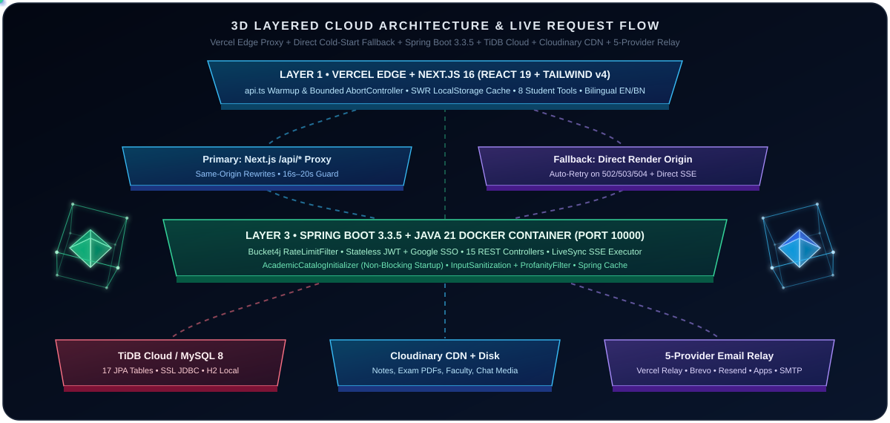
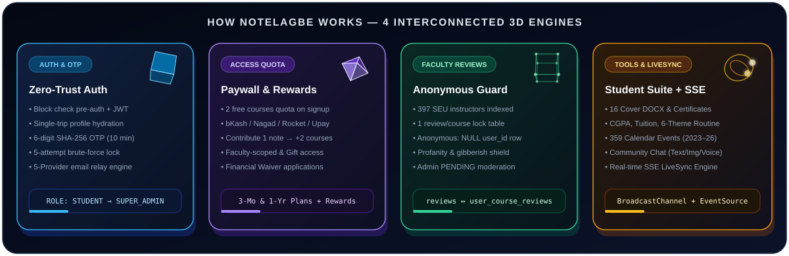
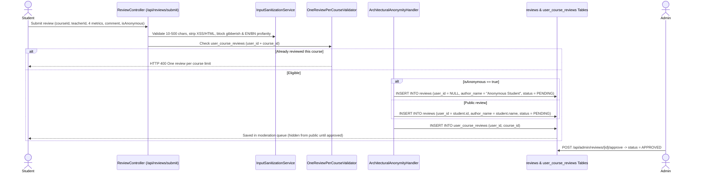
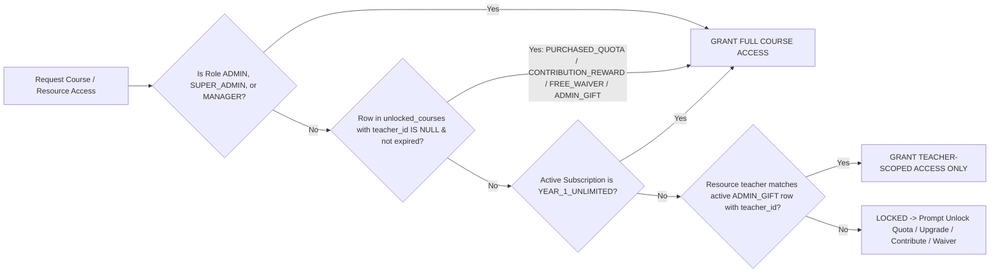
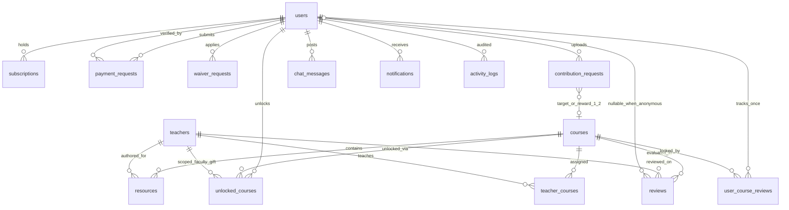

<div align="center">



<br />

[](https://note-lagbe-sandy.vercel.app)
[](./backend/pom.xml)
[](./backend/pom.xml)
[](./frontend/package.json)
[](./frontend/package.json)
[](./backend/src/main/resources/application.properties)
[](#automated-security-and-regression-tests)

<br />

**A Full-Stack University Academic Archive, Anonymous Faculty Review Platform, Exam Revision Vault & Student Toolkit for Southeast University (SEU)**

[Live System Architecture](#system-architecture) •
[Core Features & Mechanics](#core-features-and-how-they-work) •
[8-in-1 Student Suite](#5-student-productivity-suite) •
[Security & Rate Limiting](#7-security-rate-limiting-and-email-relay) •
[Database Schema](#database-architecture) •
[API Reference](#rest-api-directory) •
[Setup & Deploy](#local-development-setup)

</div>

---

## Executive Overview

**NoteLagbe (`নোট লাগবে`)** is a production full-stack academic platform engineered for **Southeast University (SEU)** students and faculty administrators. Built with a decoupled **Next.js 16 (App Router + React 19 + Tailwind CSS v4)** frontend hosted on **Vercel** and a **Spring Boot 3.3.5 (Java 21)** backend containerized with **Docker** on **Render**, backed by **TiDB Cloud Serverless (MySQL 8 SSL)**, **Cloudinary CDN**, and **Cloudflare R2 Object Storage**.

Reading this `README.md` alone gives a complete blueprint of every feature, data pipeline, security control, database table, and REST endpoint in the codebase.

### Platform Scale & Capabilities at a Glance

| Domain | Verified Scale & Capabilities | Primary Source |
| :--- | :--- | :--- |
| **Curriculum Catalog** | **85 CSE Courses** (Semesters 1–12 + Elective Groups A/B) across **11 Departments & 19 Programs** | [`courses_catalog.json`](./frontend/src/data/courses_catalog.json), [`seu_programs.json`](./frontend/src/data/seu_programs.json) |
| **Faculty Directory** | **397 SEU Instructors & Staff** indexed with room, designation, initials, avatars & course mappings | [`teachers_directory.json`](./frontend/src/data/teachers_directory.json) |
| **Study Material Vault** | **14 `ResourceType` Categories** (Hand Notes, Mid/Final/CT Questions, Lab Reports, Syllabi, Projects) + Multi-page PDF & ZIP export | [`ResourceType.java`](./backend/src/main/java/com/notelagbe/entity/ResourceType.java) |
| **Anonymous Reviews** | **5-Axis Ratings** (`Overall`, `Personality`, `Marking`, `Difficulty`, `Comment`) with architectural identity separation (`NULL user_id`) | [`ArchitecturalAnonymityHandler.java`](./backend/src/main/java/com/notelagbe/service/review/impl/ArchitecturalAnonymityHandler.java) |
| **Access & Monetization** | **4 Subscription Tiers** (`FREE` 2-course quota up to `1-Year Unlimited`), bKash/Nagad/Rocket/Upay, Financial Waivers, Contributor Rewards & Admin Gifts | [`PlanType.java`](./backend/src/main/java/com/notelagbe/entity/PlanType.java), [`UnlockSource.java`](./backend/src/main/java/com/notelagbe/entity/UnlockSource.java) |
| **Student Productivity Suite** | **8 Interactive Tools** (`/tools`): CGPA, Tuition, 16-Template DOCX Cover Maker, Certificate Maker, 6-Theme Routine Builder, 359-Event Academic Calendar (2023–2026) | [`tools/page.tsx`](./frontend/src/app/tools/page.tsx), [`academic_calendars.json`](./frontend/src/data/academic_calendars.json) |
| **Real-Time Collaboration** | Floating Community Chat (`TEXT` / `IMAGE` / `VOICE` + retention purge), Campus Notice Board, Notifications & SSE + `BroadcastChannel` LiveSync | [`LiveSyncService.java`](./backend/src/main/java/com/notelagbe/service/LiveSyncService.java), [`sync.ts`](./frontend/src/lib/sync.ts) |
| **Backend & Persistence** | **15 REST Controllers**, **17 JPA Tables**, Bucket4j per-IP Rate Limiter, 5-Provider Email Relay & **44 JUnit 5 Tests** | [`backend/`](./backend), [`frontend/`](./frontend) |

---

## Repository Blueprint

```text
noteLagbe/
├── Dockerfile                                  # Multi-stage Maven (Temurin 21 Alpine) -> JRE 21 container build (PORT=10000)
├── docs/assets/                                # Custom 3D animated SMIL SVGs embedded in this README
│   ├── notelagbe-3d-hero.svg
│   ├── notelagbe-architecture-3d.svg
│   └── notelagbe-workflows-3d.svg
├── backend/                                    # Spring Boot 3.3.5 + Java 21 REST API & Business Engine
│   ├── pom.xml                                 # JPA, Security, JJWT 0.12.6, Bucket4j, Cloudinary 1.38.0, AWS S3 / Cloudflare R2, MySQL/H2/Postgres
│   └── src/
│       ├── main/java/com/notelagbe/
│       │   ├── config/                         # SecurityConfig, RateLimitFilter, CacheConfig, SchemaMigrationRunner, WebMvcConfig
│       │   ├── controller/                     # 15 REST Controllers (Auth, Course, Teacher, Resource, Review, Admin, Chat, etc.)
│       │   ├── dto/                            # Strongly typed Request/Response DTOs
│       │   ├── entity/                         # 17 JPA Entities + Domain Enums (Role, PlanType, UnlockSource, ResourceType, ...)
│       │   ├── repository/                     # Spring Data JPA repositories + pessimistic row locks
│       │   ├── security/                       # JwtAuthenticationFilter & CustomUserDetails
│       │   └── service/                        # Auth, Course, Subscription, Contribution, Payment, Waiver, AI Revision, LiveSync, Email
│       ├── main/resources/application.properties
│       └── test/java/com/notelagbe/            # 44 JUnit 5 Security, Paywall, Moderation & Audit Tests (7 test classes)
└── frontend/                                   # Next.js 16.4.3 + React 19.3.0 + TypeScript 5 + Tailwind CSS v4
    ├── next.config.ts                          # /uploads/* & /api/* proxy rewrites + image host whitelist
    └── src/
        ├── app/
        │   ├── page.tsx, courses/, curriculum/ # Landing, Catalog Browser (85 courses), Course Vault, Program Roadmap
        │   ├── teachers/, pricing/, contribute/# Faculty Directory (397 profiles), Subscription Plans, Note Contribution Portal
        │   ├── tools/, dashboard/, admin/      # 8-in-1 Student Suite, Student Dashboard, Executive Admin Console
        │   └── api/                            # 6 Next.js Route Handlers (mail-relay, sync/events, academic-calendar, courses, ...)
        ├── components/                         # 24 UI Components (PDFViewer, CheatSheet, Chat, Cover/Certificate, Admin Tabs, Modals)
        ├── context/                            # AuthContext, LanguageContext (EN/BN), ThemeContext (Light/Dark)
        ├── data/                               # Ground-truth SEU JSON datasets (courses, teachers, programs, 2023-2026 calendars)
        └── lib/                                # api.ts (cold-start resilience + SWR cache), sync.ts (SSE + BroadcastChannel), pdfMerger.ts
```

---

## System Architecture

<div align="center">
  
</div>

### End-to-End Request Lifecycle & Cold-Start Resilience

NoteLagbe runs across free/serverless cloud infrastructure (**Vercel** + **Render** + **TiDB Cloud**), where backend cold starts and gateway timeouts would normally stall login or catalog requests for up to 2 minutes. The architecture solves this at every layer:

```mermaid
flowchart TD
    User["Student / Admin Browser (React 19 + Next.js 16)"] -->|Pre-warm GET /api/ping| Warmup["api.ts warmupBackend() - 45s Cooldown"]
    User -->|API Call via apiFetch| Primary["Vercel Rewrite (/api/* -> Backend)"]
    Primary -->|502 / 503 / 504 or 16s-20s Timeout| Fallback["Direct Backend Origin Retry (NEXT_PUBLIC_BACKEND_URL)"]
    Primary -->|Fast Response| RateLimit
    Fallback -->|24s-30s Retry Window| RateLimit

    subgraph SpringBoot["Spring Boot 3.3.5 + Java 21 Docker Container (Render)"]
        RateLimit["@Order(1) RateLimitFilter (Bucket4j Token Buckets + 350ms Double-Click Guard)"] --> JwtFilter["JwtAuthenticationFilter (Stateless Bearer JWT + Blocked Check)"]
        JwtFilter --> Controllers["15 REST Controllers + @PreAuthorize RBAC"]
        Controllers --> Services["Business Services + Spring Cache + InputSanitizationService"]
    end

    Services -->|HikariCP Pool (max 5, minIdle 1, 10s timeout)| TiDB[("TiDB Cloud / MySQL 8 SSL (17 Tables) or Local H2")]
    Services -->|Multipart Notes, Photos, Chat Audio/Images| CDN["Smart Hybrid Storage: Cloudflare R2 (>10MB / PDFs) + Cloudinary (<=10MB / Images) / Local Disk"]
    Services -->|OTP & Admin Notices| Mail["5-Provider Email Relay (Vercel Relay / Brevo / Resend / Apps Script / SMTP)"]
    Services -->|Admin/Content Mutations| SSE["LiveSyncService Daemon Executor (SSE /api/sync/events)"]
    SSE -->|Real-Time UI Invalidation| User
```

#### How Key Architectural Mechanics Work

1. **Non-Blocking Render Startup (`AcademicCatalogInitializer.java`)**:
   - On boot (`@Order(1) CommandLineRunner`), NoteLagbe synchronously ensures the `ROLE_SUPER_ADMIN` user exists and checks whether `courses` and `teachers` are populated.
   - If the catalog is already seeded (`existingCourses > 0 && existingTeachers > 0`), it defers non-CSE hygiene, teacher-course reconciliation, and cache eviction into `CompletableFuture.runAsync(...)` so the JVM binds `PORT` immediately and passes Render health checks without stalling incoming HTTP traffic.
2. **Client Cold-Start Protection & Single-Flight Caching (`frontend/src/lib/api.ts`)**:
   - **Pre-Warming**: Auth modals and landing flows trigger `warmupBackend()` (`GET /api/ping`, 45-second cooldown, 12-second abort window) so Render starts waking before form submission.
   - **Bounded Timeouts**: `fetchWithTimeout()` enforces explicit `AbortController` limits (`16s` normal JSON, `20s` `/auth/*`, `45s` `FormData` uploads).
   - **Automatic Direct Fallback**: When Vercel's `/api/*` rewrite returns `502`/`503`/`504` or times out during a cold start, idempotent reads (`GET`/`HEAD`) and `SAFE_COLD_START_RETRY_ENDPOINTS` (`/auth/login`, `/auth/register`, `/auth/google`, `/auth/forgot-password`, `/auth/verify-reset-code`, `/auth/reset-password`) wait `600ms`, emit a `notelagbe:backend-waking` UI event, and retry directly against `NEXT_PUBLIC_BACKEND_URL` (`24s`/`30s` retry window).
   - **Zero-Latency Deduplication**: `inFlightGetRequests` shares concurrent identical `GET` promises; `inFlightMutations` + `lastMutationTimestamps` block accidental double-clicks.
3. **Database Connection Stability (`application.properties` + `Dockerfile`)**:
   - `Dockerfile` runs Temurin 21 JRE Alpine with `-XX:MaxRAMPercentage=75.0 -XX:+UseSerialGC -XX:+ExitOnOutOfMemoryError -Djava.security.egd=file:/dev/./urandom` tuned for low-memory containers.
   - `HikariCP` uses `maximum-pool-size=5`, `minimum-idle=1`, `connection-timeout=10000`, `validation-timeout=3000`, `keepalive-time=60000`, `max-lifetime=240000`, `idle-timeout=180000`, and `SELECT 1` test queries so dropped TiDB Serverless idle sockets are replaced before requests fail.
4. **Live Cross-Tab Synchronization (`LiveSyncService.java` + `frontend/src/lib/sync.ts`)**:
   - Server mutations publish events via a dedicated single-thread daemon executor (`livesync-broadcaster`) across `CopyOnWriteArrayList<SseEmitter>` streams (`10-minute` TTL, auto-reconnected by `EventSource`).
   - Browser tabs additionally propagate `notelagbe:sync-data` via `BroadcastChannel("notelagbe_sync_bus")` with a `localStorage` `storage` event fallback, clearing client API caches instantly across tabs when an admin approves a review, uploads notes, or updates notices.

---

## Core Features and How They Work

<div align="center">
  
</div>

### 1. Academic Catalog & Multi-Department Curriculum
*Routes: `/`, `/courses`, `/courses/[code]`, `/curriculum`*

- **85 CSE Courses & 11 SEU Departments**: Indexes core, math/science, GED, lab, and elective tracks (`Semesters 1–12`, `Elective Group A`, `Elective Group B`) with prerequisites, credit hours, syllabus details, and live material/faculty counts. Multi-department architecture lists **11 Departments & 19 Programs** (`CSE`, `EEE`, `ARCH`, `TEX`, `PHR`, `BBA`, `LAW`, `ENG`, `BNG`, `ECO`, `ICT`), displaying Coming Soon roadmaps for upcoming non-CSE expansion.
- **Full-Box Clickable Course Cards**: On `/` and `/courses`, clicking anywhere inside a course card navigates directly to `/courses/[code]` (or `/curriculum` course drawer), respecting keyboard focus and middle-click selection.
- **Instant Stale-While-Revalidate UX**: Landing, catalog, and teacher pages hydrate immediately from structured SEU JSON datasets (`courses_catalog.json`, `teachers_directory.json`) + `localStorage` snapshots, then seamlessly reconcile live unlock status, note counts, and ratings from Spring Boot once loaded.

---

### 2. Faculty Directory & Architectural Anonymity Review System
*Routes: `/teachers`, `/teachers/[id]`, `/courses/[code]`*

- **397 Indexed Faculty & Staff Profiles**: Searchable by name, initials, designation, email, or category (`FacultyCategory`), enriched from SEU faculty sync (`SeuFacultySyncService`, `POST /api/teachers/sync-cse`) and admin photo uploads.
- **Multi-Dimensional Evaluation**: Students rate instructors per course across `1–5` scales for **Overall Rating**, **Personality**, **Marking**, and **Difficulty**, plus a validated review comment (`10–500` chars).
- **Duplicate Prevention Without Breaking Anonymity**: Every review splits accountability and public identity across two independent JPA tables:



---

### 3. Study Vault, Media Delivery & Exam Cheat Sheet Generator
*Routes: `/courses/[code]`, `/contribute`*

- **14 Academic Resource Categories (`ResourceType`)**:
  `NOTE`, `QUESTION_COURSE_IN` (Course-in Questions), `MID_QUESTION`, `FINAL_QUESTION`, `QUIZ_CT`, `DOC_NOTE`, `PROJECT_LINK`, `LAB_MANUAL`, `LAB_QUIZ`, `LAB_FINAL`, `LAB_REPORT`, `LAB_HAND_NOTE`, `SYLLABUS`, `OTHERS`.
- **Smart Hybrid Storage Pipeline (`CloudflareR2Service` + `CloudinaryService` + Local Disk)**:
  - **Files <= 10 MB & Images**: Automatically routed to **Cloudinary** for image optimization, responsive webp transformations, and fast thumbnail generation.
  - **Files > 10 MB, Handwritten Notes & Large PDFs (Up to 100 MB)**: Automatically routed to **Cloudflare R2 Object Storage** (S3-compatible, zero egress costs, no raw file size cap) to handle massive student lecture notebooks and multi-page exam bundles seamlessly.
  - **Multi-Tier Fault Tolerance**: If any cloud provider is unconfigured or encounters a transient network timeout, uploads seamlessly fall back to secondary cloud storage and local `/uploads/**` disk with zero user-facing 500 crashes.
- **Multi-Page Camera/Image -> PDF Merger (`pdfMerger.ts` & `MultiPageUploader.tsx`)**: Students can snap multiple pages of handwritten notes and merge them directly in the browser via `pdf-lib` into a single paginated PDF before uploading, with automatic portrait alignment and 100MB capacity.
- **Link SSRF Guard (`GET /api/contributions/verify-link`)**: External resource URLs (e.g., public Google Drive folders/files) pass backend validation rejecting localhost, link-local, and RFC1918 private IPs before being attached.
- **In-Browser Viewing, Batch ZIP & Revision Cheat Sheet**:
  - `PDFViewerModal.tsx` previews uploaded PDFs and slides inline (subject to unlock authorization).
  - `GET /api/courses/{code}/download-zip` packages unlocked course materials into a single ZIP archive.
  - `AiRevisionService` (`GET /api/courses/{code}/cheatsheet`) synthesizes all approved resources for a course into a structured, printable exam revision blueprint (`CheatSheetModal.tsx`) grouped by syllabus, hand notes, mid/final/quiz question papers, and lab deliverables.

---

### 4. Subscription Tiers, Paywall Engine, Payments, Waivers & Contributor Rewards
*Routes: `/pricing`, `/contribute`, `/dashboard`, `/admin`*

#### Subscription Plans (`PlanType.java`)

| Plan Code | Display Title | Price | Unlock Quota | Validity |
| :--- | :--- | :--- | :--- | :--- |
| `FREE` | Community Free Explorer | **৳0** | **2 Courses** | Permanent on signup (unless upgraded/expired) |
| `SEMESTER_1` | 1-Semester Plan (3 Months) | **৳99** | **6 Courses** | **3 Months** |
| `SEMESTER_2` | 2-Semesters Plan (6 Months) | **৳149** | **12 Courses** | **6 Months** |
| `YEAR_1_UNLIMITED` | 1-Year All Courses Access (12 Months) | **৳499** | **Unlimited (`-1`)** | **12 Months** |

#### How Access Control (`SubscriptionService` + `CourseService`) Decides Unlocking

Every course & resource check evaluates all **5 `UnlockSource` grants** and enforces race-safe quota locking:



- **Concurrent Unlock Race Protection**: Calling `POST /api/courses/{code}/unlock` acquires a JPA pessimistic write lock (`subscriptionRepository.findByIdForUpdate`) on the active subscription row before verifying `usedCoursesCount < maxCoursesAllowed` and inserting the `UnlockedCourse` record.
- **4 Bangladeshi Mobile Financial Payment Rails (`PaymentMethod`)**: Students submit `BKASH`, `NAGAD`, `ROCKET`, or `UPAY` transactions with regex-validated Bangladeshi phone (`^01[3-9]\d{8}$`), uppercase TRX ID (`^[A-Z0-9]{6,25}$`), duplicate-TRX rejection, and optional slip proof -> queued as `PENDING` for `ROLE_SUPER_ADMIN` approval.
- **Contribution Reward Economy (`/contribute`)**: Uploading or linking a genuine note and getting Admin approval automatically marks the resource `APPROVED`, unlocks **2 student-chosen courses for 3 months** (`UnlockSource.CONTRIBUTION_REWARD`), credits leaderboard rank (`GET /api/contributions/leaderboard`), and fires a notification.
- **Financial Aid Waiver (`/pricing`)**: Students experiencing financial hardship can submit their Student ID, CGPA, written explanation (`20–600` chars), and ID proof for `FREE_WAIVER` course/plan grants via Admin approval.
- **Granular Admin Gift Access (`POST /api/admin/users/{userId}/gift-course`)**: Super Admins can grant either **Full-Course** access (`teacherId = null`) or **Faculty-Scoped** access (only materials by a specific instructor inside that course) with custom validity duration.
- **Automated Expiration Daemon (`SubscriptionService`)**: Every 10 minutes (`@Scheduled`), expired subscriptions (`SEMESTER_1`, `SEMESTER_2`, `YEAR_1_UNLIMITED`) automatically lock `PURCHASED_QUOTA`/`YEAR_UNLIMITED` rows while preserving earned `CONTRIBUTION_REWARD`, `FREE_WAIVER`, and `ADMIN_GIFT` grants until each individual row's `expiresAt` timestamp elapses, then alerts users via `Notification`.

---

### 5. Student Productivity Suite
*Route: `/tools` ([`frontend/src/app/tools/page.tsx`](./frontend/src/app/tools/page.tsx))*

All **8 productivity cards** in `/tools` include bilingual (`EN`/`বাংলা`) UI support and client-side export without requiring backend processing:

| # | Tool Tab | Internal Capabilities & Export Engine | Status |
| :--- | :--- | :--- | :--- |
| **1** | **CGPA Calculator** (`cgpa`) | Multi-course SGPA & cumulative CGPA simulator using official SEU grade thresholds (`4.00 A+` ≥80% down to `0.00 F` <40%), credit weighting & retake simulation | Active |
| **2** | **Tuition & Waiver** (`tuition`) | Credit-hour fee breakdown, merit/need waiver percentage calculator & installment split estimator | Active |
| **3** | **Cover Page Maker** (`cover`) | **16 University Assignment & Lab Cover Templates** (`15 Color` + `1 BW` in `SEU_20_TEMPLATES`) with live preview and DOCX/print-ready export | Active |
| **4** | **Event Certificate Maker** (`certificate`) | [`EventCertificateMaker.tsx`](./frontend/src/components/EventCertificateMaker.tsx) custom university club/event award generator with instant PNG/PDF export (`html-to-image` / `jsPDF`) | Active |
| **5** | **Smart Routine** (`routine`) | Visual weekly timetable builder supporting SEU slots (`SUN–TUE`, `MON–WED`, `THU–SAT`, `FRI`, plus Lab intervals `08:00 AM–06:30 PM`) & **6 Color Themes** (`ROUTINE_COLOR_THEMES`) | Active |
| **6** | **Academic Calendar** (`calendar`) | [`AcademicCalendarTool.tsx`](./frontend/src/components/AcademicCalendarTool.tsx) + `/api/academic-calendar`: **4 Years (2023–2026)**, **12 Semesters**, **359 Events**, HTML-entity sanitizer, 10-min API cache & HD PNG/PDF export | Active |
| **7** | **Find Section Group** (`sections`) | Peer section & study group finder workflow card | `Soon` |
| **8** | **Smart Advising Routine** (`advising`) | Conflict-free course advising schedule assistant card | `Soon` |

---

### 6. Real-Time Community Chat, Notice Board & Notifications
*Components: [`FloatingCommunityChat.tsx`](./frontend/src/components/FloatingCommunityChat.tsx), [`HeroNoticeBoard.tsx`](./frontend/src/components/HeroNoticeBoard.tsx), [`NotificationBell.tsx`](./frontend/src/components/NotificationBell.tsx)*

- **Floating Community Chat (`ChatService` & `chat_messages`)**:
  - Supports **Text**, **Image uploads**, and **Voice audio clips** with duration tracking, reply-to threading (`replyToId`, `replyToSender`, `replyToText`), likes toggle, and admin message pinning (`pinExpiresAt`).
  - Automatic profanity masking (`ProfanityFilterService`), XSS/gibberish checks, and user-level `chatBlocked` enforcement.
  - Uses a **20-second in-memory message & pinned-message cache** alongside composite database indexes (`idx_chat_deleted_created`, `idx_chat_pinned_expires`) and a configurable **rolling retention policy** (`DEFAULT_RETENTION_DAYS = 30`, presets `7 / 15 / 30 / 60 / 90`, bounds `7–365` days) purgeable automatically or manually by Super Admin.
- **Campus Notice Board & Personal Notifications**:
  - Public active notices banner (`GET /api/notices/active`) managed live by admins.
  - Per-student notification center (`unread-count`, `read`, `read-all`, `delete`, `clear-all`) updated across payment, waiver, contribution, review, and expiration events.

---

### 7. Security, Rate Limiting and Email Relay
*Key Files: [`SecurityConfig.java`](./backend/src/main/java/com/notelagbe/config/SecurityConfig.java), [`RateLimitFilter.java`](./backend/src/main/java/com/notelagbe/config/RateLimitFilter.java), [`AuthService.java`](./backend/src/main/java/com/notelagbe/service/AuthService.java), [`EmailService.java`](./backend/src/main/java/com/notelagbe/service/EmailService.java)*

#### Zero-Trust Authentication & Google OAuth
- **Stateless Bearer JWT** (`JJWT 0.12.6`, 24h access expiration default) with `CustomUserDetails` and explicit `assertUserNotBlocked()` check (`user.isEnabled()`) executed **both at login and on every authenticated request**.
- **Single-Trip Profile Hydration**: `/api/auth/login`, `/api/auth/register`, `/api/auth/google`, and `/api/auth/me` return full `UserProfileResponse` + active subscription/quota snapshot in one round trip.
- **Verified Google Sign-In (`POST /api/auth/google`)**: Validates ID tokens server-side against `https://oauth2.googleapis.com/tokeninfo`, verifying issuer (`accounts.google.com`), `email_verified=true`, expiration, email consistency, and `GOOGLE_CLIENT_ID` audience match.

#### 6-Digit OTP Password Reset & 5-Provider Email Delivery
- **OTP Cryptography & Anti-Brute-Force**:
  - `POST /api/auth/forgot-password` generates a cryptographically random **6-digit numeric OTP**, stores only its **SHA-256 hash** (`resetOtpHash`), enforces a **10-minute expiry** (`OTP_EXPIRY_MINUTES=10`) and **45-second resend cooldown** (`OTP_RESEND_COOLDOWN_SECONDS=45`).
  - `POST /api/auth/verify-reset-code` permits up to **5 failed attempts** (`MAX_OTP_ATTEMPTS=5`) before invalidating the code, then issues a short-lived **10-minute reset token** (`RESET_TOKEN_EXPIRY_MINUTES=10`) required by `POST /api/auth/reset-password`.
- **Multi-Provider Delivery Engine (`EmailService.java` + [`mail-relay/route.ts`](./frontend/src/app/api/mail-relay/route.ts))**:
  - Supports **5 transport strategies**: `VERCEL_RELAY`, `BREVO` (HTTPS API), `RESEND` (HTTPS API), `APPS_SCRIPT` (Webhook), and direct `SMTP`.
  - When cloud PaaS hosts like Render Free Tier block outbound SMTP ports (`587`/`465`), **`EMAIL_VERCEL_RELAY_AUTO_FALLBACK=true`** signs a single-use `relayNonce` + `SHA-256("${to}\n${subject}\n${html}")` `payloadHash`, posts to Vercel's Node runtime `/api/mail-relay`, which callbacks `/api/auth/mail-relay-verify`, blocks private/loopback DNS targets (SSRF prevention), and delivers via `nodemailer` with automatic port `587` -> `465` retry.

#### Bucket4j Rate Limiting & Input Threat Shield
- **`@Order(1) RateLimitFilter`** enforces per-IP **Bucket4j** token-bucket quotas + a **350ms rapid double-mutation cooldown** (`POST`/`PUT`/`PATCH`/`DELETE`), returning localized English/Bengali `HTTP 429` JSON payloads:

| Endpoint Group | Rate Limit / Window |
| :--- | :--- |
| `/api/auth/forgot-password`, `verify-reset-code`, `reset-password` | **8 requests / minute** |
| `/api/auth/login`, `/api/auth/register`, `/api/auth/google` | **15 requests / minute** |
| `/api/payments/**` | **8 requests / minute** |
| `/api/reviews/**` (mutations) & `/api/waivers/**` | **10 requests / minute** |
| `/api/contributions/**` (mutations) | **15 requests / minute** |
| `/api/chat/**` (mutations) | **30 requests / minute** |
| `/api/teachers/sync-cse` | **5 requests / minute** |
| General API traffic (excluding whitelisted `/uploads`, `/api/sync`, `mail-relay-verify`) | **240 requests / minute** |

- **`InputSanitizationService` + `ProfanityFilterService`**: Strips `<script>`/`<iframe>`/event-handler XSS payloads, rejects `12+` consecutive consonant keyboard mashes, flags `5+` (`7+` chat) repeated character spam, enforces minimum character entropy, and screens English, Banglish transliterations, and Bengali Unicode profanity.

---

### 8. Admin Command Console & RBAC Matrix
*Route: `/admin` ([`AdminController.java`](./backend/src/main/java/com/notelagbe/controller/AdminController.java), [`AdminAnalyticsView.tsx`](./frontend/src/components/AdminAnalyticsView.tsx), [`AdminCurriculumTab.tsx`](./frontend/src/components/AdminCurriculumTab.tsx))*

Method-level `@PreAuthorize` boundaries isolate destructive and financial powers across **4 Roles**:

| Role | Permitted Administrative Capabilities |
| :--- | :--- |
| `ROLE_STUDENT` | Standard learning, unlocks, 1 review/course, community chat, notes/waiver/payment submission (blocked if `enabled=false` or `chatBlocked=true`) |
| `ROLE_MANAGER` | View analytics/stats/queues, upload & patch course materials (`/resources/upload`, `/resources/{id}/file`), create/edit courses & faculty, assign instructors, moderate reviews & contributions, moderate chat messages |
| `ROLE_ADMIN` | All `MANAGER` powers **plus** cache eviction (`/cache/clear`), delete courses/teachers/resources, create/toggle/delete staff accounts (`/staff/**`), approve/reject waivers (`/waivers/**`), manage notices (`/notices/**`) |
| `ROLE_SUPER_ADMIN` | All `ADMIN` powers **plus** view/approve/reject payments & subscriptions (`/payments/**`, `/subscriptions`), gift or revoke full/faculty course access (`/users/{id}/gift-course`), configure email relay (`/settings/email-config`), modify/purge chat retention (`/chat/retention`, `/chat/purge`), and clear audit logs (`/activity-logs/clear`) |

---

## Database Architecture

NoteLagbe persists data across **17 normalized JPA tables** (`ddl-auto=update` + startup schema hygiene in `SchemaMigrationRunner`), running cleanly on **TiDB Cloud Serverless / MySQL 8** in production and **H2 In-Memory** locally:



### Complete Table Catalog (17 Entities)

| Category | Exact `@Table` Names |
| :--- | :--- |
| **Identity & Access** | `users`, `subscriptions`, `unlocked_courses` |
| **Academic Structure** | `courses`, `teachers`, `teacher_courses`, `resources` |
| **Feedback & Moderation** | `reviews`, `user_course_reviews` |
| **Monetization & Rewards** | `payment_requests`, `waiver_requests`, `contribution_requests` |
| **Communication & Ops** | `chat_messages`, `notices`, `notifications`, `activity_logs`, `system_settings` |

---

## Tech Stack

| Layer | Technologies & Versions |
| :--- | :--- |
| **Backend Runtime** | Java 21 (Eclipse Temurin Alpine), Spring Boot 3.3.5 (Web, Security, Validation, Data JPA, Mail, Cache) |
| **Auth & Rate Limiting** | `jjwt` `0.12.6` (HMAC-SHA JWT), `bucket4j-core` `8.10.1` (Token Bucket), Google ID Token Verification |
| **Database Drivers** | `mysql-connector-j` (TiDB Cloud / MySQL 8 SSL), `postgresql`, `com.h2database:h2` (Local Dev/Tests) |
| **Media & Email** | `cloudinary-http44` `1.38.0`, `nodemailer` `10.5.0` (Next.js Relay), Brevo & Resend REST APIs, Google Apps Script, JavaMail SMTP |
| **Frontend Core** | Next.js `16.4.3` (App Router + Turbopack), React `19.3.0`, TypeScript `^5`, Tailwind CSS `^4` |
| **Frontend Utilities** | `lucide-react` `^1.62.0`, `sonner` `^2.0.8`, `jszip` `^3.10.2`, `jspdf` `^4.2.1`, `pdf-lib` `^1.17.1`, `html2canvas` `^1.4.1`, `html-to-image` `^1.11.13`, `canvas-confetti` `^1.9.4` |
| **Infrastructure** | Vercel Edge (Frontend & Rewrites), Render Docker (`PORT=10000`), TiDB Cloud Serverless, Cloudinary CDN, Cloudflare R2 Object Storage |

---

## REST API Directory

NoteLagbe exposes **15 Spring Boot Controllers** and **6 Next.js App Router API routes**:

<details>
<summary><strong>1. Public, Catalog, Curriculum & Media Endpoints</strong> (PublicController, DepartmentController, CourseController, TeacherController, ResourceController)</summary>

| Controller | Base Path | Endpoints |
| :--- | :--- | :--- |
| `PublicController` | `/api` | `GET /ping`, `GET /stats/public`, `POST /stats/visit`, `GET /plans` |
| `DepartmentController` | `/api/departments` | `GET /`, `POST /sync` *(Admin)* |
| `CourseController` | `/api/courses` | `GET /`, `GET /{code}`, `POST /{code}/unlock`, `GET /{code}/cheatsheet`, `GET /{code}/download-zip` |
| `TeacherController` | `/api/teachers` | `GET /`, `GET /{id}`, `GET /{id}/courses`, `POST /sync-cse` *(Admin)* |
| `ResourceController` | `/api/resources` | `GET /course/{code}`, `GET /teacher/{teacherId}`, `GET /check-availability`, `GET /{id}`, `GET /{id}/file`, `POST /{id}/download` |

</details>

<details>
<summary><strong>2. Authentication, OTP Recovery & Profile Endpoints</strong> (AuthController + Next.js Mail Relay)</summary>

| Controller | Base Path | Endpoints |
| :--- | :--- | :--- |
| `AuthController` | `/api/auth` | `POST /login`, `POST /register`, `POST /google`, `POST /logout`, `GET /me`, `PUT /profile`, `POST /avatar/upload`, `DELETE /avatar`, `PUT /password`, `POST /forgot-password`, `POST /verify-reset-code`, `POST /reset-password`, `POST /mail-relay-verify` |
| `Next.js API` | `/api` (Vercel) | `POST /api/mail-relay`, `GET /api/academic-calendar`, `GET /api/sync/events`, `GET /api/courses`, `GET /api/departments`, `GET /api/teachers` |

</details>

<details>
<summary><strong>3. Student Workflows: Reviews, Contributions, Payments & Waivers</strong></summary>

| Controller | Base Path | Endpoints |
| :--- | :--- | :--- |
| `ReviewController` | `/api/reviews` | `POST /submit`, `GET /check`, `GET /course/{code}`, `GET /teacher/{teacherId}`, `GET /recent` |
| `ContributionController` | `/api/contributions` | `GET /leaderboard`, `GET /verify-link`, `POST /upload`, `POST /submit`, `GET /my` |
| `PaymentController` | `/api/payments` | `POST /submit`, `GET /my` |
| `WaiverController` | `/api/waivers` | `POST /submit`, `GET /my` |

</details>

<details>
<summary><strong>4. Real-Time Chat, Notices, Notifications & LiveSync SSE</strong></summary>

| Controller | Base Path | Endpoints |
| :--- | :--- | :--- |
| `ChatController` | `/api/chat` | `GET /messages`, `GET /pinned`, `GET /active-count`, `POST /messages`, `POST /voice`, `POST /image`, `POST /messages/{id}/like` |
| `NoticeController` | `/api/notices` | `GET /`, `GET /active` |
| `NotificationController` | `/api/notifications` | `GET /`, `GET /unread-count`, `POST /{id}/read`, `POST /read-all`, `DELETE /{id}`, `DELETE /clear-all` |
| `LiveSyncController` | `/api/sync` | `GET /events` (`text/event-stream`), `GET /status` |

</details>

<details>
<summary><strong>5. Executive Admin & Moderation Endpoints</strong> (AdminController — 50+ Endpoints)</summary>

| Domain | Endpoints under `/api/admin` |
| :--- | :--- |
| **KPIs, Cache & Logs** | `GET /analytics`, `GET /stats`, `POST /cache/clear`, `GET /activity-logs`, `POST /activity-logs/clear`, `DELETE /activity-logs` |
| **Courses & Faculty** | `POST/PUT/DELETE /courses/**`, `POST/DELETE /courses/{code}/teachers/{teacherId}`, `POST/PUT/DELETE /teachers/**`, `POST /teachers/upload-photo` |
| **Materials** | `GET /resources`, `POST /resources/upload`, `POST/PUT /resources/{id}`, `PATCH /resources/{id}/file`, `DELETE /resources/{id}`, `GET /resources/{id}/file` |
| **Staff & Gift Access** | `GET/POST/PUT/DELETE /staff/**`, `PUT /staff/{id}/toggle-status`, `POST /users/{userId}/gift-course`, `GET/DELETE /users/{userId}/unlocked-courses/**` |
| **Approval Queues** | `GET /payments`, `GET /subscriptions`, `POST /payments/{id}/approve`, `POST /payments/{id}/reject`, `GET /contributions`, `POST /contributions/{id}/approve`, `POST /contributions/{id}/reject`, `DELETE /contributions/{id}`, `GET /waivers`, `POST /waivers/{id}/approve`, `POST /waivers/{id}/reject`, `GET /reviews`, `POST /reviews/{id}/approve`, `POST /reviews/{id}/reject`, `DELETE /reviews/{id}` |
| **Settings, Notices & Chat** | `GET /settings`, `PUT /settings/email-config`, `POST /settings/send-test-email`, `POST /settings/email-toggle`, `GET/PUT /profile`, `POST /avatar/upload`, `DELETE /avatar`, `PUT /password`, `GET/POST/PUT/DELETE /notices/**`, `PUT /notices/{id}/toggle-status`, `DELETE /chat/messages/{id}`, `POST /chat/messages/{id}/pin`, `POST /chat/messages/{id}/unpin`, `POST /chat/users/{userId}/block`, `POST /chat/users/{userId}/unblock`, `GET/PUT /chat/retention`, `POST /chat/purge` |

</details>

---

## Environment Variables Reference

Configure via Render / Vercel environment settings (never commit `.env*` or `*.yml` credentials):

| Scope | Variables | Purpose / Default |
| :--- | :--- | :--- |
| **Server & DB** | `PORT`, `SPRING_DATASOURCE_URL`, `SPRING_DATASOURCE_USERNAME`, `SPRING_DATASOURCE_PASSWORD`, `SPRING_DATASOURCE_DRIVER_CLASS_NAME`, `SPRING_JPA_DATABASE_PLATFORM`, `SPRING_JPA_HIBERNATE_DDL_AUTO`, `HIKARI_MAX_POOL_SIZE` | Defaults to `8888`, H2 in-memory locally, `max-pool-size=5` for TiDB/MySQL SSL |
| **Security & OAuth** | `JWT_SECRET`, `JWT_EXPIRATION`, `JWT_REFRESH_EXPIRATION`, `GOOGLE_CLIENT_ID`, `CORS_ALLOWED_ORIGINS` | 24h access (`86400000ms`), 7d refresh (`604800000ms`), Google ID token validation |
| **Admin & Safety** | `INITIAL_ADMIN_EMAIL`, `INITIAL_ADMIN_PASSWORD`, `APP_OWNER_EMAIL`, `APP_DEMO_ENABLED`, `APP_CATALOG_INIT` | `APP_DEMO_ENABLED=false`, `APP_CATALOG_INIT=true` |
| **Cloudinary CDN** | `CLOUDINARY_CLOUD_NAME`, `CLOUDINARY_API_KEY`, `CLOUDINARY_API_SECRET` | Enables HTTPS CDN uploads for standard images and files <= 10MB; falls back to `./uploads` disk when blank |
| **Cloudflare R2** | `R2_ACCOUNT_ID`, `R2_ACCESS_KEY_ID`, `R2_SECRET_ACCESS_KEY`, `R2_BUCKET_NAME`, `R2_PUBLIC_URL` | High-speed S3 storage for files > 10MB, large handwritten notes & PDFs up to 100MB with zero egress bandwidth charges |
| **Email Relay** | `EMAIL_ENABLED`, `EMAIL_PROVIDER`, `EMAIL_FROM`, `EMAIL_FROM_NAME`, `EMAIL_FRONTEND_URL`, `EMAIL_VERCEL_RELAY_AUTO_FALLBACK`, `EMAIL_WEBHOOK_URL`, `EMAIL_WEBHOOK_SECRET`, `BREVO_API_KEY`, `RESEND_API_KEY`, `SMTP_HOST`, `SMTP_PORT`, `SMTP_USER`, `SMTP_PASS` | Multi-provider OTP delivery & Vercel `/api/mail-relay` fallback |
| **Frontend Proxy** | `BACKEND_INTERNAL_URL`, `NEXT_PUBLIC_BACKEND_URL`, `NEXT_PUBLIC_API_URL`, `NEXT_PUBLIC_GOOGLE_CLIENT_ID`, `NEXT_PUBLIC_APP_URL` | Controls `/api/*` rewrite destination & direct cold-start fallback origin |

---

## Local Development Setup

### Prerequisites
- **Java 21 JDK** & **Maven** (or Maven Wrapper if present)
- **Node.js 20+** & **npm**

### 1. Run Backend (`localhost:8888`, zero external setup required)
Defaults to H2 in-memory database and seeds all **85 CSE courses** and **397 SEU teachers** automatically on boot:
```bash
cd backend
mvn spring-boot:run
```

### 2. Run Frontend (`localhost:3000`)
```bash
cd frontend
npm install
npm run dev
```

### 3. Production Build & Docker Check
```bash
# Frontend Type-Check & Build
cd frontend && npx tsc --noEmit && npm run build

# Backend Docker Image (Render Target, PORT=10000)
docker build -t notelagbe-backend .
docker run -p 10000:10000 -e SPRING_DATASOURCE_URL="..." notelagbe-backend
```

---

## Automated Security and Regression Tests

The backend includes **44 automated JUnit 5 tests** across **7 dedicated suites** covering security hardening, paywall isolation, anonymous review moderation, RBAC, password recovery, chat retention, and email relay configuration:

```bash
cd backend && mvn test
```

| Test Suite | Tests | Verified Behaviors |
| :--- | :---: | :--- |
| [`SecurityHardeningAndPaywallTest.java`](./backend/src/test/java/com/notelagbe/security/SecurityHardeningAndPaywallTest.java) | **9** | SSRF URL validator, magic-byte/MIME/size file validation, resource paywall masking & streaming, payment/waiver quota guards, scheduled cache eviction, Google claim verification, login principal reuse & non-blocking SSE broadcast |
| [`PasswordResetSecurityTest.java`](./backend/src/test/java/com/notelagbe/security/PasswordResetSecurityTest.java) | **7** | Anti-enumeration unknown-email check, 6-digit OTP masking, 45s resend cooldown, 5 wrong-attempt invalidation, OTP expiry & single-use reset token |
| [`EmailDeliveryConfigurationTest.java`](./backend/src/test/java/com/notelagbe/service/EmailDeliveryConfigurationTest.java) | **7** | `VERCEL_RELAY` nonce + SMTP fallback, `BREVO` HTTPS delivery, `APPS_SCRIPT` validation, Gmail App Password space stripping, `SUPER_ADMIN` secret masking & sender mojibake repair |
| [`AccountBlockingEnforcementTest.java`](./backend/src/test/java/com/notelagbe/security/AccountBlockingEnforcementTest.java) | **6** | Blocked account rejection on password login, Google OAuth, password reset requests & live JWT filter (`ACCOUNT_BLOCKED` error code) |
| [`AdminAuditAndClearLogsTest.java`](./backend/src/test/java/com/notelagbe/service/AdminAuditAndClearLogsTest.java) | **6** | `ROLE_SUPER_ADMIN` password confirmation to clear audit logs, resource file patch auditing & queue/gift audit trails |
| [`ChatRetentionAndOrderingTest.java`](./backend/src/test/java/com/notelagbe/service/ChatRetentionAndOrderingTest.java) | **6** | Default 30-day retention, 7–365 day validation, chronological fetch of newest 150 messages, expired media purge & Super Admin RBAC |
| [`FacultyGiftAccessTest.java`](./backend/src/test/java/com/notelagbe/service/FacultyGiftAccessTest.java) | **3** | Faculty-scoped `ADMIN_GIFT` isolation (blocks sibling instructors' materials), full-course reward compatibility & bell + email dispatch |
